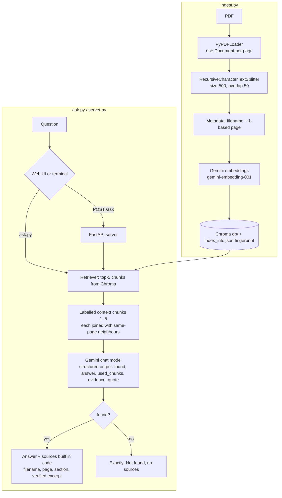
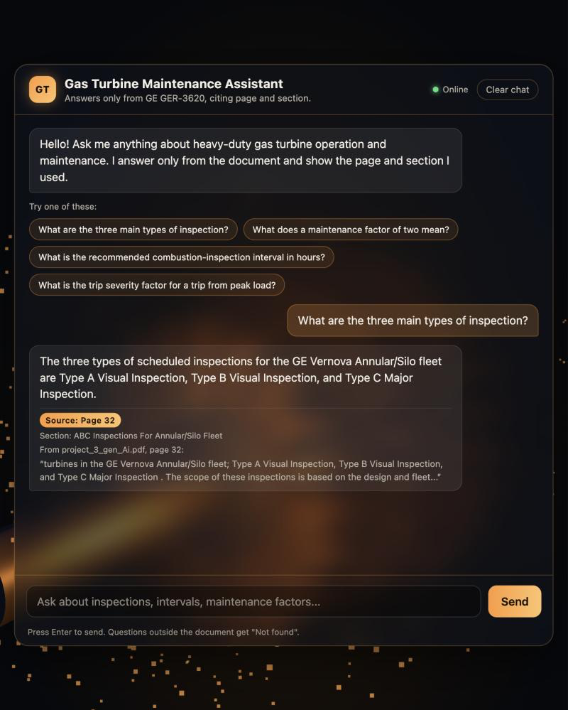
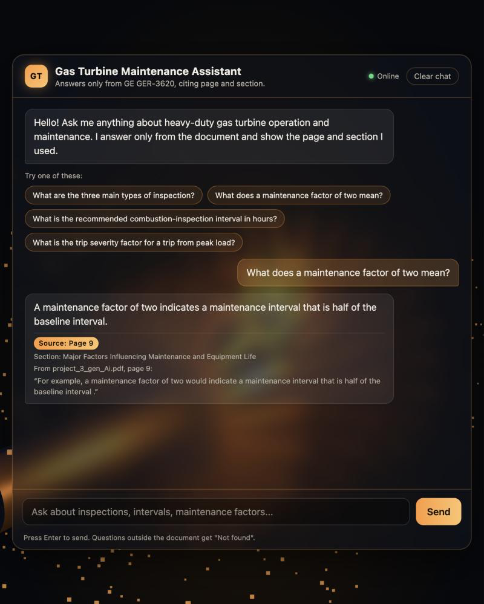
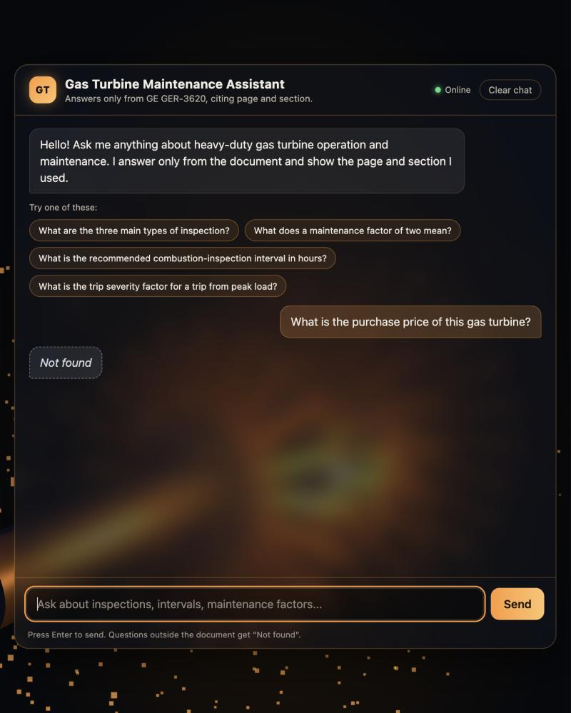
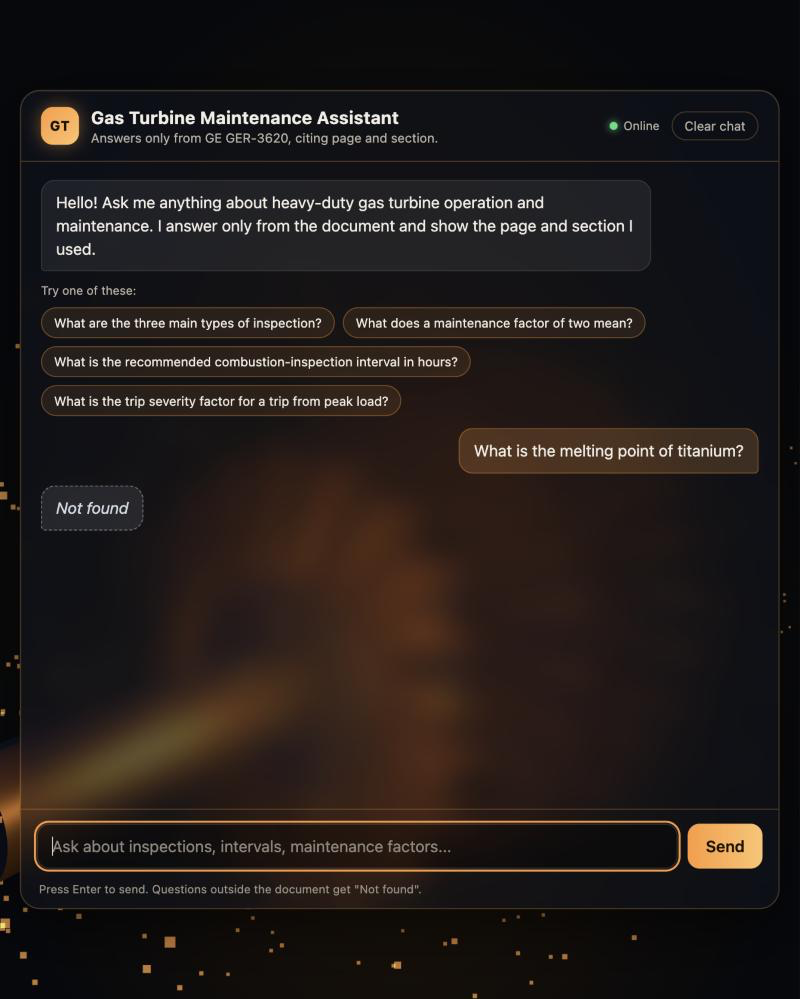
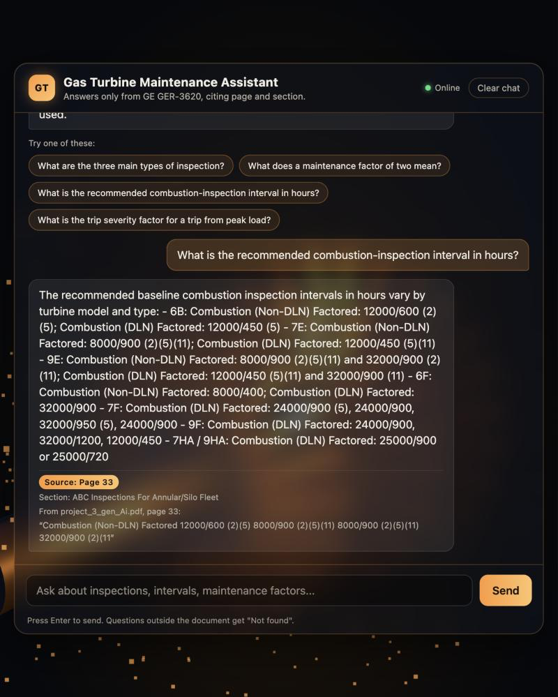

# Gas Turbine Maintenance Assistant (RAG)

A Retrieval-Augmented Generation (RAG) assistant that answers questions about the GE Vernova document *Heavy-Duty Gas Turbine Operating and Maintenance Considerations* (GER-3620P, 60 pages). It uses Python, LangChain, ChromaDB and Google Gemini. Every answer comes with a page reference and a short excerpt from the document. When the answer is not in the document, it replies exactly `Not found`. It runs in the terminal and in a web chat UI (FastAPI + one HTML page).

**Problem statement:** maintenance engineers need fast, trustworthy answers from long maintenance documents. A plain chatbot can invent values, so this assistant answers only from the document, cites where the answer is, and says "Not found" instead of guessing.

## Project flow

Plain text: `PDF -> PyPDFLoader -> RecursiveCharacterTextSplitter (500/50) -> Gemini embeddings -> Chroma (db/)`, then `question -> UI or terminal -> FastAPI /ask -> retriever (top-5) -> labelled chunks [1]..[5] -> Gemini (structured output) -> found? -> answer + page reference, or "Not found"`.



## Tech stack

| Part | Choice |
|---|---|
| Language | Python 3.10+ (tested on 3.13.12) |
| PDF loading | `langchain_community.document_loaders.PyPDFLoader` (pypdf) |
| Chunking | `langchain_text_splitters.RecursiveCharacterTextSplitter` |
| Embeddings | `langchain_google_genai.GoogleGenerativeAIEmbeddings`, model `gemini-embedding-001` |
| Vector store | `langchain_chroma.Chroma` + `chromadb`, persistent folder `db/` |
| Chat model | `langchain_google_genai.ChatGoogleGenerativeAI`, model `gemini-3.5-flash-lite`, temperature 0.1 |
| Chain | LangChain LCEL: `ChatPromptTemplate | model.with_structured_output(LLMAnswer)` + post-processing in code |
| API | FastAPI + uvicorn |
| UI | One `index.html` with embedded CSS/JS, Three.js 0.170.0 from cdnjs (ES module) |

Installed versions used for this build: langchain-core 1.7.0, langchain-community 0.4.2, langchain-text-splitters 1.1.3, langchain-chroma 1.1.0, chromadb 1.5.9, langchain-google-genai 4.4.2, fastapi 0.161.1, uvicorn 0.54.0, pypdf 6.21.2.

## Project structure

```
gas_turbine_rag/
  config.py            settings from env vars, Gemini factories, retry with backoff
  ingest.py            PDF -> chunks -> embeddings -> Chroma (fingerprinted, safe rebuild)
  ask.py               retrieval + LCEL chain + post-processing; terminal loop
  evaluate.py          runs eval_questions.json, writes results/evaluation.md
  run_questions.py     answers questions.txt, writes results/answers.md and results/lms_answers.txt
  server.py            FastAPI: GET /, GET /health, POST /ask
  index.html           chat UI with 3D turbine background
  eval_questions.json  12 in-document + 5 out-of-document evaluation questions
  questions.txt        the 5 questions to submit (currently SAMPLE questions)
  tests/               pytest suite (fake embeddings and fake LLM, no API calls)
  data/                put the PDF here (data/project_3_gen_Ai.pdf)
  results/             generated reports
  screenshots/         screenshots for submission
  .env.example         configuration template (no secrets)
  requirements.txt, requirements-dev.txt
```

## Setup and run

The PDF goes in `data/project_3_gen_Ai.pdf`, or point `DOCUMENT_PATH` at it in `.env`.

### 1. Virtual environment and install

macOS / Linux (bash):
```bash
python3 -m venv .venv
source .venv/bin/activate
pip install -r requirements-dev.txt
```

Windows PowerShell:
```powershell
py -m venv .venv
.\.venv\Scripts\Activate.ps1
pip install -r requirements-dev.txt
```

### 2. Environment variables

Copy `.env.example` to `.env` and set `GOOGLE_API_KEY` (a Gemini API key from Google AI Studio). `.env` is git-ignored. `GEMINI_API_KEY` is also accepted.

bash: `cp .env.example .env`   PowerShell: `Copy-Item .env.example .env`

Or set the key only for the current shell:
bash: `export GOOGLE_API_KEY="your-key"`   PowerShell: `$env:GOOGLE_API_KEY="your-key"`

### 3. Run (same commands in both shells once the venv is active)

| Step | Command |
|---|---|
| Build the index | `python ingest.py` (`python ingest.py --rebuild` to force) |
| Ask in the terminal | `python ask.py` |
| Answer questions.txt | `python run_questions.py` |
| Evaluate | `python evaluate.py` |
| Start the server | `uvicorn server:app --reload --port 8000` |
| Open the UI | browse to http://localhost:8000/ (or open `index.html` directly while the server runs) |
| Tests | `python -m pytest -q` |

After a rebuild, restart the server so it loads the new index.

## How references work

- PyPDFLoader returns one document per PDF page with a 0-based `page` index. `ingest.py` converts it to a 1-based page number in one place (`split_pages`) and stores only `source` (filename) and `page` with each chunk.
- Page numbers are physical PDF pages (page 1 = cover). The document's printed page labels are different (for example PDF page 31 is printed page 27).
- At question time the top-k chunks are labelled `[1]..[k]` in the prompt. The model returns `used_chunks`, the labels it actually used.
- The model also returns `evidence_quote`, a sentence copied word for word from the chunk. Code checks that the quote really appears in that page's chunk text; only then is it shown as the evidence. Otherwise the start of the chunk is shown. So every answer says which page it came from and shows the supporting sentence from that page.
- **Section citation:** every source also names the document section. The section titles come from the PDF's own table of contents; each title is located as a heading line in the page text (contents page numbers are mapped to PDF pages through the PDF page labels as a fallback), and a chunk belongs to the last heading before it. This is computed in code, never by the model.
- Sources are built in code from chunk metadata, never from model text: invalid labels are dropped, so the model cannot invent a page. If no label is valid, all retrieved chunks are used. Sources are de-duplicated by page and sorted, and each carries an excerpt of at most about 200 characters from the chunk text.

## How "Not found" works

1. The prompt tells the model to answer only from the numbered chunks and set `found=false` when they do not contain the answer. The chunks are treated as untrusted data, and requests such as "ignore the document" are ignored.
2. In code: if `found` is false, or the answer text (case-insensitive, punctuation stripped) equals "not found", the final answer is exactly `Not found` with `found: false` and `sources: []`.
3. Optional relevance pre-filter (`RELEVANCE_MAX_DISTANCE`): skips the LLM when the closest chunk is too far away. It is meant to be enabled only if the evaluation shows a clear distance gap. Measured result: the distances overlap, so it is **off** (see [Evaluation results](#evaluation-results)).

## Design choices

- **Chunk size 500, overlap 50:** small chunks keep each retrieved piece focused on one value or rule, so page references stay precise. The overlap keeps sentences that cross a boundary readable.
- **Top-k = 5:** started at 3; raised to 5 because table rows (for example Figure 36 on page 33) are split across several small chunks. Evaluation accuracy was identical at 3 and 5, so 5 costs nothing in accuracy and recovers table answers.
- **Embedding model `gemini-embedding-001`:** documented as available and stable for text by Google. Google now also lists `gemini-embedding-2` as its latest model; 001 was kept because this project is text-only.
- **Structured output (Pydantic `found`, `answer`, `used_chunks`, `evidence_quote`):** gives a machine-readable found flag and chunk labels, so "Not found" and references are decided by code, not by parsing free text. A malformed structured answer is retried once.
- **Neighbour-chunk context:** small 500-character chunks cut tables apart (model header in one chunk, values in the next). After retrieval, each chunk is joined with the chunks just before and after it on the same page, so the model sees the header and can tell which value belongs to which model. If several answers apply (by model, type or condition), the prompt requires listing all of them grouped by type.
- **Index fingerprint:** a SHA-256 of the PDF bytes, chunk size, overlap and embedding model, stored in `db/index_info.json`. Re-running ingest with the same fingerprint does nothing. A change (or `--rebuild`) builds into `db.building/` and swaps it in only after success, so a failed build keeps the old index.
- **Retries:** Gemini calls retry 429 and transient errors with exponential backoff (5 tries). Embeddings go in batches of 20 with a 12 s pause between batches (`EMBED_PAUSE_SECONDS`), because the free tier rejected an unpaced run of 494 chunks; the paced ingest takes about 5 minutes. After that the user gets a clear error. The key is never printed.

### Changing models

Model IDs were checked against Google's model list (ai.google.dev/gemini-api/docs/models) on 2026-10-23. If Google retires one, set a current ID in `.env`:
```
GEMINI_CHAT_MODEL=<new chat model id>
GEMINI_EMBEDDING_MODEL=<new embedding model id>
```
Changing the embedding model requires `python ingest.py --rebuild`. The app detects a mismatch and tells you so.

## API

`POST /ask` with `{"question": "..."}` returns:
```json
{"answer": "string", "found": true, "sources": [{"filename": "project_3_gen_Ai.pdf", "page": 10, "section": "Starts and Hours Criteria", "excerpt": "..."}]}
```
"Not found" returns `{"answer": "Not found", "found": false, "sources": []}`. Errors always use `{"error": {"code": "...", "message": "..."}}`: 400 `blank_question`, 409 `index_not_built` / `embedding_model_mismatch`, 422 `validation_error`, 429 `provider_rate_limited`, 502 `provider_error`, 500 `internal_error`. `GET /health` returns `{"status": "ok"}`, and `GET /` serves the UI.

CORS is fully open (`*`, no credentials) so the UI works from `file://` and other local ports. Before any public deployment, restrict `allow_origins` to the real site, add authentication and rate limiting, and serve over HTTPS.

## Evaluation results

Real run of `python evaluate.py` (12 in-document questions covering values, intervals, a definition, procedures and a warning on pages 10-27, plus 5 out-of-document questions: 2 near-miss gas turbine questions, 2 unrelated, 1 "ignore the document" override). Final settings: `gemini-3.5-flash-lite`, `gemini-embedding-001`, chunk 500/50, top-k 5, prompt rule for model-specific values. Full table: [results/evaluation.md](results/evaluation.md).

| Metric | Result |
|---|---|
| Answer correct (in-document, all key facts present) | 11/12 (92%) |
| Page correct (in-document, expected page returned) | 11/12 (92%) |
| Not found correct (out-of-document) | 5/5 (100%) |
| False 'Not found' (in-document) | 1/12 (8%) |

- The one miss: "How is peak load defined?" returned Not found (a false negative, not a wrong answer). Its top-1 distance (0.649) was the worst of the in-document set: the short question did not retrieve the page 11 chunk.
- **Tuning (recorded honestly):** before any tuning (top-k 3, [results/evaluation_before_tuning.md](results/evaluation_before_tuning.md)): answers 11/12, pages 11/12, Not found 5/5, false Not found 1/12. Change 1, top-k 3 -> 5 plus a prompt rule about model-specific values ([results/evaluation_topk5_prompt1.md](results/evaluation_topk5_prompt1.md)): the same numbers. Change 2, neighbour-chunk context plus the rule "if there are several answers by type, list all of them grouped by type" (final, [results/evaluation.md](results/evaluation.md)): answers 11/12, **pages 12/12, false Not found 0/12**, Not found 5/5. The changes were motivated by the official question on combustion inspection intervals, whose answer is a table split across chunks; the fixes are general and the evaluation questions were not changed.
- **Relevance pre-filter: not added.** Measured top-1 L2 distances overlap: in-document 0.215-0.649, out-of-document 0.480-0.842. There is no threshold that separates them with margin, so "Not found" relies on the model flag. `RELEVANCE_MAX_DISTANCE` stays empty (off).

## Answers

Official assignment questions, real output of `python run_questions.py`. Plain-text version for the LMS form: [results/lms_answers.txt](results/lms_answers.txt).

### 1. What are the three main types of inspection?

**Answer:** The three types of scheduled inspections for the GE Vernova Annular/Silo fleet are Type A Visual Inspection, Type B Visual Inspection, and Type C Major Inspection.

**Reference:** project_3_gen_Ai.pdf, page 32, section "ABC Inspections For Annular/Silo Fleet"

> Page 32: "turbines in the GE Vernova Annular/Silo fleet; Type A Visual Inspection, Type B Visual Inspection, and Type C Major Inspection . The scope of these inspections is based on the design and fleet..."

### 2. What does a maintenance factor of two mean?

**Answer:** A maintenance factor of two indicates a maintenance interval that is half of the baseline interval.

**Reference:** project_3_gen_Ai.pdf, page 9, section "Major Factors Influencing Maintenance and Equipment Life"

> Page 9: "For example, a maintenance factor of two would indicate a maintenance interval that is half of the baseline interval ."

### 3. What is the purchase price of this gas turbine?

**Answer:** Not found

**Reference:** No reference (not in the document)

### 4. What is the melting point of titanium?

**Answer:** Not found

**Reference:** No reference (not in the document)

### 5. What is the recommended combustion-inspection interval in hours?

**Answer:** The recommended combustion inspection intervals in hours vary by turbine model and configuration as listed below:
- 6B Combustion (Non-DLN) Factored: 12000
- 6B Combustion (DLN) Factored: 12000
- 7E Combustion (Non-DLN) Factored: 8000
- 7E Combustion (DLN) Factored: 12000
- 9E Combustion (Non-DLN) Factored: 8000 (and 32000 for specific columns)
- 9E Combustion (DLN) Factored: 32000
- 6F Combustion (Non-DLN) Factored: 8000
- 6F Combustion (DLN) Factored: 32000
- 7F Combustion (Non-DLN) Factored: 24000
- 7F Combustion (DLN) Factored: 24000 (and 32000 for specific columns)
- 9F Combustion (DLN) Factored: 24000, 32000, and 12000
- 7HA/9HA Combustion (DLN) Factored: 25000

**Reference:** project_3_gen_Ai.pdf, page 33, section "ABC Inspections For Annular/Silo Fleet"

> Page 33: "Combustion (Non-DLN) Factored 12000/600 (2)(5) 8000/900 (2)(5)(11) 8000/900 (2)(5)(11) 32000/900 (2)(11"

**Review notes (checked by hand against the PDF text):**
- Q1: the answer is grounded (page 32 says "There are three types of scheduled inspections"). The document also classifies inspections more broadly on page 25 as standby, running and disassembly inspections, where disassembly covers combustion, hot gas path and major inspections.
- Q3 and Q4 are correctly "Not found": the document gives no purchase price and no melting point of titanium.
- Q5: the document has no single interval; Figure 36 (page 33) lists baseline combustion inspection intervals per model in factored hours/starts. The assistant lists all of them grouped by type. Because the table is flattened by the PDF loader, wording and completeness vary slightly between runs; the Q5 screenshot below shows a run whose values all match Figure 36 (6B 12000/600 non-DLN, 12000/450 DLN; 7E/9E 8000/900 non-DLN, 12000/450 DLN, 9E.04 32000/900; 6F 8000/400 non-DLN, 32000/900 and 24000/900 DLN; 7F 24000/900, 32000/950; 9F 24000/900, 32000/1200, 12000/450; 7HA/9HA 25000/900 and 25000/720).

## Screenshots

Real screenshots of the web UI (http://localhost:8000/) for the 5 official questions, each showing the question asked, the answer, its page and section reference and the quoted evidence. The UI shows an online/offline status indicator and clickable suggested questions.

### Q1. What are the three main types of inspection?

Answer shown: Type A Visual, Type B Visual and Type C Major Inspection. Source: page 32, section "ABC Inspections For Annular/Silo Fleet".



### Q2. What does a maintenance factor of two mean?

Answer shown: the maintenance interval is half of the baseline interval. Source: page 9, section "Major Factors Influencing Maintenance and Equipment Life".



### Q3. What is the purchase price of this gas turbine?

Answer shown: Not found (not in the document, no source shown).



### Q4. What is the melting point of titanium?

Answer shown: Not found (not in the document, no source shown).



### Q5. What is the recommended combustion-inspection interval in hours?

Answer shown: all model-specific intervals from Figure 36, grouped by turbine type. Source: page 33, section "ABC Inspections For Annular/Silo Fleet".



Note: each screenshot is a separate live model call, so its wording can differ slightly from `results/answers.md`. For Q5 the exact per-model values are listed in the review notes above (Figure 36, page 33); the PDF loader flattens that table, so a single run can omit or repeat a value.

## Known limitations

- PyPDFLoader extracts tables and multi-column layouts imperfectly; some figure tables in this PDF come out as run-together text, so values that appear only inside figures may be missed or mis-cited.
- Scanned (image-only) pages are not supported (no OCR). This PDF has extractable text on all 60 pages.
- Answer quality depends on the Gemini models; the same question can be worded slightly differently between runs.
- The Gemini free tier has low rate limits; large runs may pause for backoff or fail with a rate-limit error.
- The accuracy numbers come only from the 17-question evaluation set and are not a general guarantee.
- Permissive CORS is for local development only.
- `langchain-community` (which provides PyPDFLoader) shows a deprecation notice that the package is being sunset; it works today but may need replacing with a standalone loader later.

## Possible improvements

- Hybrid search (keyword + vector) for exact part numbers and values.
- Table-aware PDF parsing for figure tables.
- A re-ranker before the LLM to improve page precision.
- A larger evaluation set reviewed by a maintenance engineer.
- Streaming answers in the UI.
